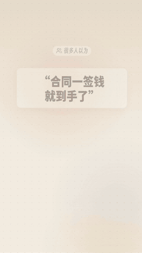

# 口播成片

> **第一次打开会弹提示框，照着点就行。** 双击「剪一条」时，Windows 会弹「打开文件 - 安全警告」，写着「无法验证发布者」，点 **运行**。要是弹的是蓝色的「Windows 已保护你的电脑」，点 **更多信息**，再点 **仍要运行**。这是因为软件没买数字签名，Windows 认不出发布者。

> **持续升级维护中！** 新版本都发在本页右侧 **Releases**，怎么换新版见下面「更新与反馈」。

把手机录的口播放进 Windows 电脑，就能剪出一条带字幕的竖屏视频。免费，不用注册。

[看 15 秒有声成片](docs/demo_audio.mp4)

这条样片是 1.2 版出的，取自一段真实的手机录音，只有声音，画面全是软件自己出的。1.3 的字卡换了排法，出来的样子和它不一样。

## 能做什么

- **只有录音也能出片。** 画面是一张张字卡：正在说的那句最大最亮，说过的缩小变灰。换卡看你说话的停顿。
- **三套样式。** 首页「录音配色」里挑：深蓝、米白、方格本。颜色、质感、字体一起换。
- **九种小图形。** 说到几点，出个圆盘钟，说「很久」就拉一根长条；说差距越拉越大，画两条拉开的线，说越来越多就画一笔往上的箭头；说少了、跌了，画一笔往下的箭头；说「不让」「不能」，给那个词套上圈加斜杠；说「拿某某举例」，把那个词拎出来；说要留神的地方，把那个词框住；说替你办好了，在那个词旁边打个勾；连着几句一个句式，排成一列；引别人说的话，把那句话装进对话框。认不准就不用，所以一条片里不多。
- **数照你说的写。** 小数点、负号都留着。画面上的大数字一出来就是对的数，照抄不准的只出字幕。
- **出完片能改字。** 在「修改字幕和画面」里改听错的字，去掉或加上画面上的词，图标也能去掉，封面大字也能改。改完点「重新生成」。
- **对着镜头录的视频也行。** 勾上「真人精剪」，真人原声和画面都留着。说到强调词时，录像展开成几张相纸，再接回你说话的画面。

## 手里有哪种素材？

| 放进来 | 能得到什么 |
|---|---|
| 对着镜头录的视频 | 一条保留真人和原声的竖片。按说话的时间排字幕，在强调词出现时展开相纸。 |
| 只有人声的录音 | 用录音做带字幕和字卡的竖片，可以不出镜。 |
| 句间有长停顿的口播 | 打开自动剪辑，程序会缩短识别到的长停顿，留下实际剪切记录。没有合适剪点的片段会保留。 |
| 有同音错字的初稿 | 对照原话修改识别文字，重新导出，视频里的字幕和单独的 SRT 会一起更新。 |

每条导出一个 **1080 × 1920 的 MP4**（字幕已经压进画面，可以直接发）、一份 **SRT 字幕**，以及 **3:4 和 9:16 两张封面**。

适合 3 秒到 10 分钟的单人普通话口播，单个文件最大 2 GB。听写会听错同音字，人名和专业词尤其容易错，导出前自己看一遍。

## 第一次使用：三步，不用另外装东西

要一台 **64 位的 Windows 10 或 11 电脑**。苹果电脑用不了。

**① 下载**

到本页右侧 **Releases**，在 **Assets** 里只下 **koubo-chengpian-1.4.2-mianzhuang.zip** 这一个（约 353 MB）。软件要用的 Python、组件、FFmpeg 和听写模型都在里面。**别点页面上方绿色的 Code 按钮**，那里下的是源码，不能直接用。

**② 解压**

在下好的压缩包上点右键 → **全部解压缩**，在弹出的框里把位置改成 **`D:\koubo`**（电脑只有 C 盘就写 `C:\koubo`），点 **提取**。解开约 720 MB，要等一会儿。

别放进 OneDrive 文件夹，也别在压缩包里直接双击文件。位置尽量短：放得太深，路径太长，会解压失败。

**③ 双击**

打开解压出来的文件夹，双击 **剪一条.cmd**（电脑不显示扩展名的话，它就叫 **剪一条**），浏览器会自己打开软件页面。双击后会闪一下黑色小窗，一两秒自己关掉，软件在后台接着跑。**用完了，点首页右上角的「关掉软件」。** 软件开着时再双击一次，只是把首页再打开一次。

弹出「打开文件 - 安全警告」（写着「无法验证发布者」），点 **运行**；弹出蓝色的「Windows 已保护你的电脑」，点 **更多信息** → **仍要运行**。

**以后每次用，只做第 ③ 步。**

不用管理员权限，不用打命令，不用重启。包里带的 Python 和 FFmpeg 只在这个文件夹里用，不装进系统，也不碰你电脑上已经装的 Python 和 FFmpeg。位置最好写全英文，比如 `D:\koubo`。字卡用电脑上的 Edge 或 Chrome 来画，包里不带浏览器。

### 剪第一条

1. 手机录的先传到电脑上（比如用微信发给「文件传输助手」，在电脑上另存）。
2. 点页面上的导入框，选这段录音或者口播视频。第一次先拿十几秒的试。只有录音的，可以在「录音配色」里挑一套样式。
3. 放的是视频，**真人精剪** 默认勾着，会留下你的真人画面；不想露脸就取消。点 **开始生成**。
4. 出来以后看一遍。有听错的字、不想要的词，在 **修改字幕和画面** 里改掉，点 **重新生成**。
5. 满意了点 **下载视频**。成片、字幕和两张封面也都存在软件文件夹的 **出片** 里。

### 打不开？看是哪一种

| 看到的 | 这样做 |
|---|---|
| 解压时说路径太长、找不到文件 | 解压位置改短，写 `D:\koubo`，再解一次 |
| 黑色窗口里写「找不到软件要用的 Python」 | 多半是在压缩包里直接双击的。先照第 ② 步解压，再到解出来的文件夹里双击 |
| 黑色窗口里写「少了模型文件」或「软件的文件不全」 | 压缩包没解完整。删掉解出来的文件夹，照第 ② 步重新解压一次 |
| 黑色窗口里写别的「口播成片没能启动」 | 照它说的做；还不行，把文件夹里 runtime\运行记录.txt 发邮件到 asai816@proton.me，别发到 Issues |
| 浏览器没自己打开 | 再双击一次「剪一条」；还不行，在浏览器地址栏里输入 `127.0.0.1:8765` |
| 页面提示「找不到能用的浏览器」 | 电脑上没有 Edge，也没有 Chrome。装一个 Chrome 再试 |
| 别的报错 | 截个图（别截到首页「次数码」那一格），到本页上方 **Issues** 发出来 |

## 专业版

专业版已经开卖：39.9 元，300 条，从第一次用的那天起一年内有效。条数和期限以软件里「了解专业版」那页写的为准。

- **先试再买：** 每台电脑可以免费试 3 条，不用填码。
- **适合五分钟以内的口播。**
- **多了什么：** 云端帮你排画面，画面多两种样子可挑：全息、象形图形。换个样子重新生成，不另扣条数。
- **发什么出去：** 开了云端，发字幕文字和每句开始的秒数，另外带上记数用的设备号、次数码，和按这条录音文件算出来的一串记号（用来认出同一条录音、不另扣条数，从这串记号还原不出录音）；录音和视频不上传。不开云端，录音、视频、字幕都不出你的电脑。
- **用完或到期：** 云端就停，软件照常能用，画面改在你电脑上排。
- **怎么买：** 打开软件，点首页最下面「了解专业版」，照那一页付款。付款时在备注里写上你的邮箱，24 小时内把次数码发到这个邮箱。拿到码，填进首页「次数码」那一格，点「保存」。
- **付款时忘了写邮箱：** 发邮件到 asai816@proton.me，附上付款截图。
- **退款：** 码一条都没用过的，全额退。一年内我们停止云端服务的，按剩下的整月退。用过一条以上的，不退。

## 更新与反馈

- 新版本都发在本页右侧 **Releases**，每一版写明改了什么。想第一时间知道：点本页右上角 **Watch** → **Custom** → 勾上 **Releases**。
- **软件不会自己更新。** 打开时它会向我们的服务器问一次有没有新版，有新版，首页右上角会写「有新版」，点了去下载。换新版：下新的免安装包，解压到一个新文件夹，双击 **剪一条.cmd**。
- **问新版带什么：** 只带软件的版本号，不带设备号、次数码，也不带录音、视频、字幕。和打开网页一样，服务器那头看得到你的网络地址。问不到就算了，不弹错，不耽误打开。不想让它问：先点「关掉软件」，用记事本打开软件文件夹里的 `设置.json`，找到写着 `"中转地址"` 的那一行，把冒号后面引号里的网址删掉，两个引号留着（改完是 `"中转地址": "",`），保存，再双击「剪一条」。这样专业版的云端和免费试用也都用不了。
- 用着出了问题，到本页上方 **Issues** 里说一声：卡在哪一步、屏幕上报了什么字，最好附截图（别截到首页「次数码」那一格）。运行记录（runtime\运行记录.txt）别发到 Issues，发邮件到 asai816@proton.me。我看到会回，能修的修好发新版。

> [!WARNING]
> **删旧文件夹之前，先把里面的「出片」文件夹挪出来！** 你做过的成片都存在那里，删了就找不回来。

## 署名与授权

作者 **AS暗流**（AS Anliu）。

免费版**不需要激活码，不需要注册**。听写用的是本地模型 SenseVoice-Small，视频由 FFmpeg 合成。出片时软件借用电脑上的 Edge 或 Chrome 画画面，画的时候它不往外连。不开云端的话，软件自己只在两个时候连我们的服务器：打开时问一次有没有新版（见上面「更新与反馈」）；你点开「了解专业版」那一页时，取条数、期限和收款码。这两回都不带录音、视频、字幕。模型与第三方组件各自的来源、署名和使用条款见[第三方组件说明](第三方组件.md)。
